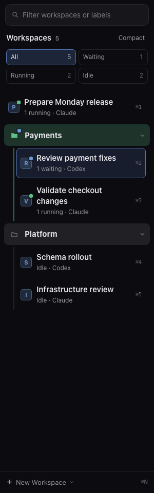

# Readable workspace navigation

The workspace sidebar starts with larger names and a second line showing current activity and Claude or Codex. Long names wrap to two lines. Existing groups, nested workspaces, keyboard shortcuts and workspace order stay in place.

- **All** shows your normal groups and workspace order.
- **Waiting** finds workspaces marked as awaiting input. This includes an agent that has finished a turn and is ready for your next instruction, as well as one waiting for an answer.
- **Running** finds workspaces with running work and no waiting input.
- **Idle** finds workspaces with no running work or waiting input.

Counts include workspaces inside collapsed groups and nested workspaces. A mixed workspace appears under Waiting; its row also shows running work. These are native live statuses, not proof that a task completed. Confirmed questions, worker completion and saved results stay in the Agents plugin.

Text search and activity filters work together. Filtered rows show their group or parent, even if that group is collapsed. Click a result, or press Enter in the search field, to open the workspace and clear both filters. Escape in search also clears both filters. Reordering is available in All with an empty search, so a filtered list cannot accidentally move hidden workspaces.

Choose **Compact** to restore the original row density. Choose **Larger** to return to the readable layout. The preference is saved on this device. Activity filters start at All when Kelpi opens, so a forgotten filter cannot hide sessions.

The image uses sample workspaces. No session data or permission settings change with this feature.

The side panel, including Agents, now has a draggable inner edge. Drag left or right to resize between 240px and 640px. The width is remembered per device and works when the sidebars swap sides.

The side-panel divider has a visible grip. Focus the divider and use Left/Right arrows for 24px adjustments, or Home/End for the width limits. Pointer capture keeps the drag working over plugin frames. The bundled Inspector fills the chosen width too.
